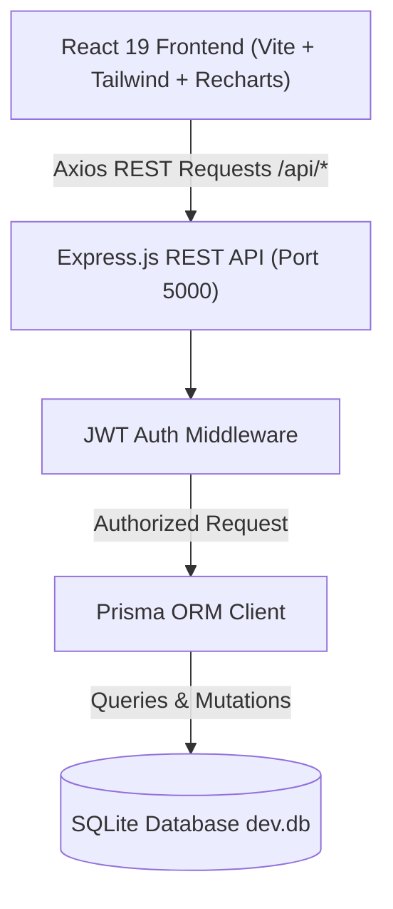
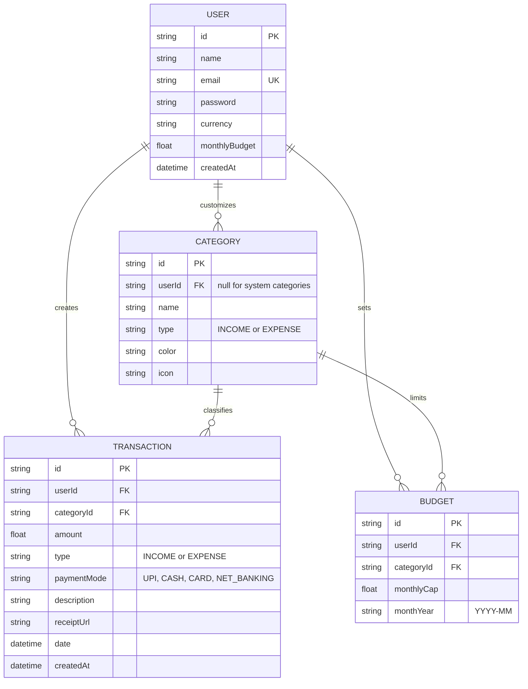

# SpendWise — Production-Ready Full-Stack Expense Management Application

> **A modern full-stack web application designed for comprehensive personal expense management, budget tracking, cash flow analytics, smart financial insights, and instant financial reporting.**

---

## 🌟 Evaluator & Viva Highlights

When presenting this project for academic evaluations, hackathons, or technical reviews, these standout features deliver maximum scores:

1. **Smart Financial Health & Insights Engine:**
   - Automatically computes a **Financial Health Score (0–100)** with real-time grading (*"Excellent"*, *"Very Good"*, *"Needs Attention"*).
   - Dynamic **Daily Spending Run-Rate** and projected month-end expenditures.
   - Intelligent rule-based financial advice highlighting top spending categories and budget adherence.

2. **Real-Time Visual Budget Alerts:**
   - Visual progress bars shift dynamically: **Green (< 70%)**, **Amber (70% – 90%)**, and **Red (> 90%)**.
   - Warning banners and badges trigger in real-time when category spending exceeds 85% or breaches 100% of limits.
   - Overall target monthly budget progress bar comparing total spending to the user's monthly cap.

3. **Dedicated Financial Reports & Statement Printing (`/reports`):**
   - Deep analytics across customizable periods (1 Month, 3 Months, 6 Months, 1 Year, All Time).
   - **Payment Method Distribution:** Interactive Donut chart analyzing spending across UPI, Credit Cards, Cash, and Net Banking.
   - **Daily Cash Flow Timeline:** Area chart tracking daily inflows and outflows.
   - **Day-of-the-Week Habits:** Bar chart revealing peak spending days (e.g., weekends vs. weekdays).
   - **Printable Financial Statement:** Formatted print view (`window.print()`) for clean physical/PDF statements.

4. **1-Click Demo Data Generator (For Evaluators):**
   - In **Settings**, evaluators can register a brand new account and click **"Populate 3-Month Sample Data"** to immediately generate 25 realistic transactions and 5 category budgets with zero manual data entry!
   - Includes a **"Reset My Records"** button to wipe data back to a clean slate anytime.

5. **Batch Transaction Management & Quick Date Presets:**
   - Multi-select checkboxes to delete multiple transactions in one click.
   - Quick date filters (*"This Month"*, *"Last 7 Days"*, *"Today"*, *"All Time"*).
   - Global keyboard shortcut: Press `N` anywhere in the app to open the Add Transaction modal.

6. **Relational Data Integrity with Foreign Key Cascades:**
   - SQLite backed by Prisma ORM enforces referential integrity with `onDelete: Cascade` on User-Transaction and User-Budget relations.

7. **Multi-Currency & Dark/Light Theme:**
   - Live switching between **INR (₹)**, **USD ($)**, **EUR (€)**, and **GBP (£)** across all cards, charts, and tables.
   - Dark and light theme toggle persisted in `localStorage`.

---

## 🛠️ Technology Stack

| Layer | Technologies |
|---|---|
| **Frontend** | React 19, Vite, Tailwind CSS v4, Lucide React (Icons), Recharts |
| **Routing & State** | React Router v7, React Context API (`AuthContext`, `ThemeContext`, `CurrencyContext`) |
| **Notifications** | React Hot Toast |
| **Backend** | Node.js, Express.js (ES Modules) |
| **Database & ORM**| SQLite with Prisma ORM v6 (`dev.db`) |
| **Authentication** | JWT (JSON Web Tokens) with HTTP-only Cookies & `Bearer` token fallback, Bcrypt password hashing |

---

## 📐 Architecture & System Flow



### Entity Relationship Diagram (ERD)



---

## 🚀 Quick Start Guide

### Prerequisites
- **Node.js** (v18 or higher installed)
- **npm** (v9 or higher)

### 1. Start the Backend API Server (Terminal 1)
```powershell
cd "d:\fs project\server"
npm run dev
```
*The server will start on [http://localhost:5000](http://localhost:5000).*

### 2. Start the Frontend Client (Terminal 2)
```powershell
cd "d:\fs project\client"
npm run dev
```
*The client will start on [http://localhost:5173](http://localhost:5173).*

Now open [http://localhost:5173](http://localhost:5173) in your browser!

---

## 🔑 Demo Login Credentials

The SQLite database is pre-seeded with 43 realistic transactions, 12 categories, and 5 budgets:

- **Email:** `demo@spendwise.com`
- **Password:** `password123`

*(You can also sign up a brand-new user at `/register` and click **"Populate 3-Month Sample Data"** in **Settings**.)*

---

## 📡 REST API Reference

All endpoints (except login & register) require authentication (`Authorization: Bearer <token>` or HTTP-only cookie).

### Authentication & Profile (`/api/auth`)
| Method | Endpoint | Description |
|---|---|---|
| `POST` | `/api/auth/register` | Register new user account |
| `POST` | `/api/auth/login` | Log in and receive JWT token + session cookie |
| `GET` | `/api/auth/me` | Return currently authenticated user profile |
| `PUT` | `/api/auth/profile` | Update user name, default currency, and monthly budget |
| `PUT` | `/api/auth/password` | Change user password |
| `POST` | `/api/auth/seed-demo` | **1-Click demo seeder:** Populates 25 sample transactions & 5 budgets |
| `DELETE`| `/api/auth/reset-data` | Wipes personal transactions and budgets |
| `POST` | `/api/auth/logout` | Invalidate session |

### Transactions (`/api/transactions`)
| Method | Endpoint | Description |
|---|---|---|
| `GET` | `/api/transactions` | Paginated list with filtering (date, type, category, search) and sorting |
| `POST` | `/api/transactions` | Create transaction `{ categoryId, amount, type, paymentMode, description, date, receiptUrl }` |
| `PUT` | `/api/transactions/:id` | Update transaction (ownership verified) |
| `DELETE`| `/api/transactions/:id` | Delete single transaction |
| `POST` | `/api/transactions/batch-delete` | Delete multiple transactions at once `{ ids: [...] }` |

### Analytics & Reports (`/api/analytics`)
| Method | Endpoint | Description |
|---|---|---|
| `GET` | `/api/analytics/summary` | Current month total income, expenses, balance, savings rate, and trends |
| `GET` | `/api/analytics/category-breakdown` | Expenses aggregated by category for Donut/Pie charts |
| `GET` | `/api/analytics/monthly-trend` | Last 6 months aggregated cash flow (income vs expenses) |
| `GET` | `/api/analytics/insights` | Smart Financial Health Score (0-100), daily run-rate, projected spend, recommendations |
| `GET` | `/api/analytics/reports?period=` | Deep reports: payment mode breakdown, day-of-week habits, daily timeline |

### Budgets (`/api/budgets`)
| Method | Endpoint | Description |
|---|---|---|
| `GET` | `/api/budgets?monthYear=` | Fetch category budgets with computed actual spending |
| `POST` | `/api/budgets` | Upsert budget limit `{ categoryId, monthlyCap, monthYear }` |
| `DELETE`| `/api/budgets/:id` | Delete budget cap |

### Categories (`/api/categories`)
| Method | Endpoint | Description |
|---|---|---|
| `GET` | `/api/categories` | Fetch all system categories + user's custom categories |
| `POST` | `/api/categories` | Create custom category `{ name, type, color, icon }` |
| `DELETE`| `/api/categories/:id` | Delete custom category |

### Export (`/api/export`)
| Method | Endpoint | Description |
|---|---|---|
| `GET` | `/api/export/csv` | Download filtered transaction history as an Excel-ready CSV file |
